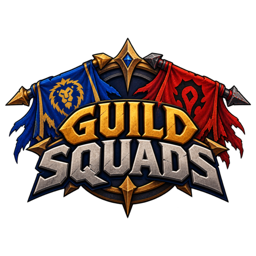

# Guild Squads

  

**Español → [README.es.md](README.es.md)**

Addon for **World of Warcraft: Forever** (client 1.60.1, `## Interface: 16001`). Current version: see the badges above or [CHANGELOG.md](CHANGELOG.md). MIT license. Author: Raul Illana.

## What it is
Guild-only squads of 5, with the guild master in control:

- **Squads of 5** (captain + starters + bench 0–2), with a name, crest, motto and tags. Joining needs both sides: the captain lists you **and** your profile points to the squad.
- Member **profiles** (role, play hours, goals) and an in-guild **Finder** with explained suggestions.
- **Rankings** per **wipe** (weekly, reset Wednesday 09:00 realm time) and per **season**; PvE categories (leveling, dungeons, raids) and PvP categories (battlegrounds, world PvP).
- **Hall of Fame** (guild Top N races) and dated squad/player **achievements** ([ACHIEVEMENTS.md](docs/en/ACHIEVEMENTS.md)).
- **The GM tailors the catalog** (**Settings > Achievements**): enable or disable each achievement or race (one by one, per group or all at once), change the size and visible name of an open Top, create up to 50 custom achievements on what the addon already measures, and grant badges by hand with a reason. Disabled entries keep counting and what was already earned stays under **Legacy**.
- **Raids**: rosters of 10/20/40, RSVP (Yes/Maybe/No/Bench), "Invite confirmed", attendance.
- Optional **celebrations** in guild chat (off by default).
- Copyable **diagnostics** with `/gsq diag`.
- **English and Spanish** throughout: interface, default achievements and races, statuses and celebrations follow the client language. Guild-chat announcements use the language of the client that announces.

## Diagrams
Diagrams (PNG; interactive HTML and index in [docs/en/diagrams](docs/en/diagrams/README.md)): [architecture](docs/en/diagrams/png/01-architecture.png) · [squad lifecycle](docs/en/diagrams/png/02-squad-lifecycle.png) · [sync](docs/en/diagrams/png/03-sync.png) · [GM settings](docs/en/diagrams/png/04-gm-settings.png) · [scoring](docs/en/diagrams/png/05-scoring.png) · [wipe/season](docs/en/diagrams/png/06-wipe-season.png) · [raids](docs/en/diagrams/png/07-raids.png) · [Hall of Fame](docs/en/diagrams/png/08-hall-of-fame.png).

## Install
1. Download the release zip (CurseForge, Wago or GitHub Releases).
2. Unzip into `Interface\AddOns\GuildSquads` inside the Forever client folder (you should end up with `Interface\AddOns\GuildSquads\GuildSquads.toc`).
3. Log in with a character that is in a guild.

## First steps
1. `/gsq` opens the window; the welcome guide walks you through profile → squad → ranking.
2. **My profile**: set role and main goal and save. The tab shows a **"!"** while the profile is incomplete. Leaving with unsaved changes offers **Save and exit**.
3. Create a squad or find one in **Squads** / **Finder**.
4. GM: open **Settings**, go through the sections and press **Save and share** ([GM-GUIDE.md](docs/en/GM-GUIDE.md)).
5. GM: in **Settings > Achievements** choose which achievements and races your guild uses (checkbox, **Enable/Disable all**, Top size, name), create your own with **New achievement** and grant badges under **Grant**. Every change is shared at once (no "Save").

## Commands
| Command | What it does |
|---|---|
| `/gsq` (or `/gsq toggle`) | Open/close the window (there is also a "Guild Squads: open" key binding) |
| `/gsq help` | Command list |
| `/gsq sync` | Ask the guild for missing data (once per minute) |
| `/gsq diag` | Copyable diagnostics report |
| `/gsq export` / `/gsq import` | Text backup |
| `/gsq minimap` | Show the minimap button again |
| `/gsq welcome` · `/gsq news` | Welcome guide · what's new |
| `/gsq ui` | Which templates/atlases this client has (fallback report) |
| `/gsq debug` | Counters + verbose log |

## GM settings
Only the GM (rank 0) writes settings; everyone else sees them read-only. Sections: **Squads**, **Compet.** (on/off, weight 0–3 and cap per category, weekly goal), **Season**, **Integr.** (Overlord), **Moderation**, **Celebrate**, **Content** (final boss per dungeon/raid), **Raids** (RL list, permissions, useful classes) and **Achiev.** (GM only: catalog of achievements and races, custom achievements, granted badges). Details: [GM-GUIDE.md](docs/en/GM-GUIDE.md).

## How scoring works
5 categories: **Leveling**, **Dungeons**, **Raids**, **PvP**, **World PvP**. Default cap **100 per category and wipe** (max 500), GM-configurable (50/100/150/200) with weights 0–3; **Overall** is the weighted sum. Bosses and battlegrounds need **2 squad members** reporting within 180 s. Scores are computed locally from events, never transmitted. Details: [scoring diagram](docs/en/diagrams/png/05-scoring.png) and [PLAYER-GUIDE.md](docs/en/PLAYER-GUIDE.md#how-scoring-works-in-plain-words).

## Privacy and Blizzard rules
- Synced **only** over the **GUILD** addon channel (prefix `GSquads`) and addon whispers between guild members: settings, squads, profiles, progress events (levels, bosses, battlegrounds, world PvP), Hall of Fame observations, the GM's achievement catalog, raid rosters/RSVP/attendance.
- Nothing leaves the guild. No external servers, no telemetry, no embedded libraries.
- **No gold or economy data, no ads, nothing for sale.** No game automation: raid invites need one click per batch, out of combat; nothing is sent during encounters or PvP matches. Designed to comply with Blizzard's addon policy.
- Local data in `GuildSquadsDB` (SavedVariables), kept per guild.

## FAQ
- **Does the whole guild need the addon?** No, but only players with it can join a squad and score. Levels of members without it are seen in the guild roster and count for the level races.
- **Can I be in two squads?** No, one per character. Your alts can be in others, and an alt in another guild keeps its data apart.
- **Why does my score differ from a guildmate's?** Each client computes the ranking from the events it has; once you both have the same data, it matches.
- **Can an officer change the settings or the achievement catalog?** No: only the GM (rank 0). Officers moderate squads and relay data.
- **Does it cost anything?** No. Free, MIT, no ads, no donations.

## Troubleshooting
- `/gsq diag` → Ctrl+A, Ctrl+C and paste it in the issue.
- Data file: `WTF\Account\<ACCOUNT>\SavedVariables\GuildSquads.lua` (in the Forever client folder).
- With no GM or officer online, a freshly logged-in client only receives what authors publish live. See [PLAYER-GUIDE.md](docs/en/PLAYER-GUIDE.md).

## Known limitations
- No cryptographic signatures: a GM/officer running a modified client can still forge relays.
- With no GM or officer online, each player only receives what authors publish live.
- A full resync of a large guild takes minutes by design (throttle).
- Forever encounter/instance IDs are unknown: instances match by name and learn the ID when seen.
- The 1.60.1 client has no `UnitPVPRank`: PvP rank achievements and races are not shown there.
- There is no Legacy Points API in 1.60.1 either: those races stay as "pending data".
- Forever raids open on 9-Dec-2026: until then the Raids category shows the "Raids open on 9-Dec" notice.
- The Forever client has been seen not reading SavedVariables back on login: run `/gsq export` now and then and keep the text (`/gsq import` restores it).
- No squad chat.

## Status
**Stable.** Logic (`Core/`), transport and the full flow are tested outside the game with unit tests and a multi-client simulator ([SIMULATOR-RESULTS.md](docs/en/SIMULATOR-RESULTS.md)). Architecture: [ARCHITECTURE.md](docs/en/ARCHITECTURE.md). Changes: [CHANGELOG.md](CHANGELOG.md).

## Docs
[docs/en/INDEX.md](docs/en/INDEX.md) · Players: [PLAYER-GUIDE.md](docs/en/PLAYER-GUIDE.md) · GM/officers/RL: [GM-GUIDE.md](docs/en/GM-GUIDE.md) · Achievements: [ACHIEVEMENTS.md](docs/en/ACHIEVEMENTS.md) · Architecture: [ARCHITECTURE.md](docs/en/ARCHITECTURE.md) · Simulator: [SIMULATOR-RESULTS.md](docs/en/SIMULATOR-RESULTS.md) · Release: [RELEASE.md](docs/en/RELEASE.md) · Diagrams: [docs/en/diagrams](docs/en/diagrams/README.md) · Contributing: [CONTRIBUTING.md](CONTRIBUTING.md) · Security: [SECURITY.md](SECURITY.md)

Every document also exists in Spanish under [docs/es/](docs/es/INDEX.md), with the same file names.

## License
MIT — see [LICENSE](LICENSE).
